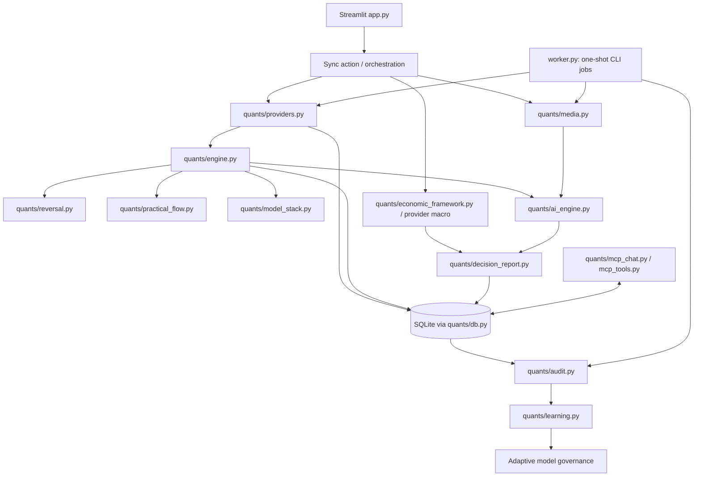
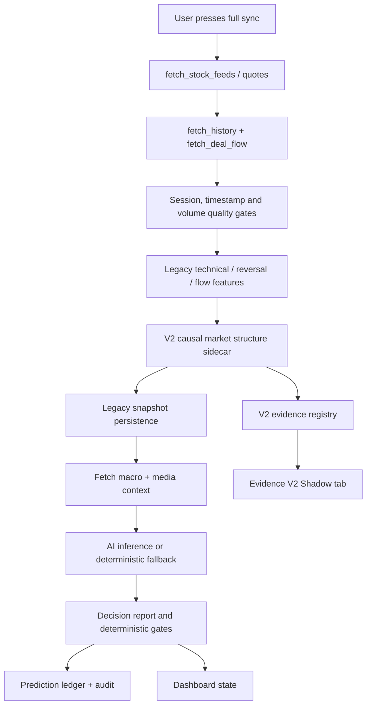
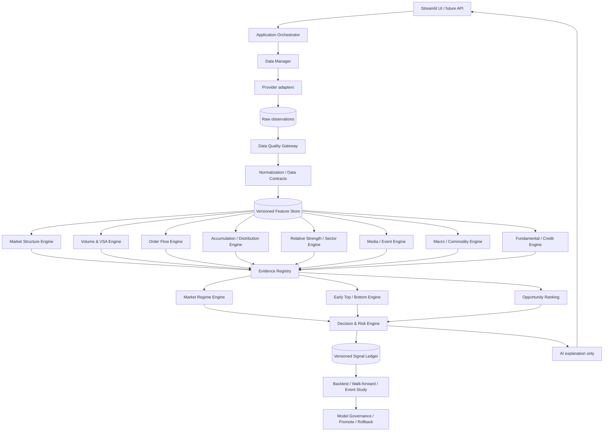

# Smart Money Flow — Architecture Blueprint V2

**Baseline:** deployment ZIP `dongtiencamap-main(20261030-143021).zip`  
**Initial migration release:** V2.1 Shared Data Quality & Orchestration  
**Status:** P0 foundation delivered in shadow mode; legacy decision path remains authoritative.

## 1. Decision for the migration

Do not rewrite the application in one release. Keep the current Streamlit application and the existing quant pipeline operational. Introduce versioned contracts and independent engines behind an orchestration boundary. Migrate one engine at a time, compare it with the legacy path in shadow mode, and promote only after historical and out-of-sample validation.

The V2 shadow layer is not a new trading model. It is the first migration slice: it converts selected fields already produced by the legacy pipeline into traceable evidence records, records data provenance/quality, and counts at most one vote per evidence group. It does not modify legacy rows or decisions.

## 2. Current architecture observed in source

### Observations grounded in the current source

- The application is a **modular monolith**: functional code is split across modules, while `app.py` coordinates sync, AI, decision reporting, persistence, and UI.
- `compute_quant()` in `quants/engine.py` orchestrates quote, history and deal-flow retrieval, data gates, feature calculations, reversal features, flow summaries, scores and snapshot persistence.
- `quants/reversal.py` contains both daily-pattern features and reversal/memory logic. `quants/practical_flow.py` computes descriptive flow setup labels and sector flow aggregates.
- `quants/decision_report.py` explicitly labels the composite as a deduplicated heuristic and does not treat proxy flow or heuristic P(win) as confirmed institutional flow or calibrated odds.
- `quants/learning.py` and the governance UI support candidate calibration, approval and rollback; this is not evidence that all feature engines are adaptively trained.
- `worker.py` exposes one-shot jobs. The README says scheduling belongs on an external persistent host; it must not be assumed to run continuously on Streamlit Community Cloud.
- SQLite is used by the application. The README warns that Streamlit Community Cloud local storage may not persist across rebuilds/restarts.

### Current synchronization flow observed in `app.py` / `compute_quant()`

The V2 sidecar is parallel to the decision path: it observes the quant row after its core fields are calculated, but its output is not fed into AI or the legacy decision gates in this release.

## 2.1 P0 foundation delivered in release 2.1

- `quants/smf_v2/data_quality.py` provides shared daily OHLCV normalization and explicit quality counters.
- `quants/smf_v2/orchestrator.py` provides a thin boundary that invokes Market Structure and VSA independently and returns shared data-quality metadata.
- `quants/engine.py` now attaches `smf_v2_data_quality` alongside the existing structure and VSA results. Existing result keys are preserved.
- Both engines fail closed when an explicit `as_of_date` is malformed. They return `INVALID_AS_OF_DATE` rather than silently analyzing an unbounded series.
- The Shadow report exposes `bar_data_quality`.
- No legacy score, AI prompt, decision gate, forecast field, or database schema was changed.

Validation for release 2.1: 282 tests passed, 1 skipped; compile check passed; `init_db()` was rehearsed against a temporary copy of the supplied backup and created the missing V2 tables without deleting existing rows. See `docs/SMF_P0_FOUNDATION_RELEASE.md`.
\n## 3. Target architecture

### Design boundaries

1. **Provider adapters** fetch raw observations only. They do not assign a bullish/bearish trade recommendation.
2. **Quality gateway** validates source timestamp, freshness, units, duplicates, OHLC consistency, session alignment, missing values and cross-source divergence.
3. **Normalization** creates stable contracts. Raw provider payloads remain available for audit; normalized values retain source lineage.
4. **Feature store** separates raw observations from calculated features and records the feature version and `as_of` time.
5. **Analytical engines** own one analytical responsibility each. They emit evidence records, not final buy/sell actions.
6. **Evidence Registry** stores provenance, quality, polarity, conflicts and independence group. In V2.0, structure, momentum divergence and price-pattern flags share one `PRICE_ACTION` vote because they are all derived from overlapping OHLC history; several correlated indicators cannot create several independent votes.
7. **Decision & Risk Engine** combines eligible evidence under a versioned policy and applies market, data, liquidity and risk gates.
8. **AI** explains supported evidence and missing data. It cannot upgrade an evidence quality label, invent data, or bypass deterministic risk gates.
9. **Validation and Governance** measure predictive/trading outcomes and control model promotion. New engines remain shadowed until they pass.

## 4. Initial V2.0 implementation delivered

New package: `quants/smf_v2/`

| File | Responsibility |
|---|---|
| `contracts.py` | `DataEnvelope` and `EvidenceRecord`, schema version, validation and serialization |
| `evidence.py` | Legacy-row adapter, independent evidence groups, proxy-flow suppression, duplicate-vote prevention |
| `shadow.py` | Per-symbol Shadow report with data quality, evidence, group votes and guardrails |
| `flags.py` | `SMF_V2_SHADOW_ENABLED` feature switch |
| `market_structure.py` | Causal daily swing pivots, BOS/CHoCH and failed-break events; future bars excluded by `as_of_date` |

Application integration:

- After `compute_quant()`, `app.py` builds the Shadow report.
- The report is stored in Streamlit session state and rendered in a separate **BẰNG CHỨNG V2 (SHADOW)** tab.
- `compute_quant()` also attaches a nested `smf_v2_market_structure` result generated from completed feature bars. The structure engine confirms a pivot only after its configured right-side bars have completed and evaluates breaks only against previously confirmed levels.
- It does not create a new table or prediction-ledger entry and does not change legacy score columns, AI output or decision gates. The nested V2 market-structure result is included in the existing `metrics_json` snapshot payload through the current snapshot persistence path.
- Set `SMF_V2_SHADOW_ENABLED=0` to disable it. Default is enabled.

### V2.0 evidence groups

| Group | Current mapping | Rules |
|---|---|---|
| `PRICE_ACTION` | V2 causal swing structure, momentum divergences and price-pattern candidates | These price-derived signals share one vote; opposing evidence becomes CONFLICTED |
| `LEGACY_TREND_DIAGNOSTIC` | Legacy `trend_state` and weekly MA fields | Diagnostic only, not a second structure vote |
| `RELATIVE_STRENGTH` | `rs_vni`, `rs_sector` | One combined vote; requires verified quote and valid index for VERIFIED status |
| `VOLUME_BEHAVIOR` | Stopping volume, no supply, high-volume rejection and related VSA flags | Related VSA flags cluster into one group |
| `ORDER_FLOW` | Net flow, real-deal flag, coverage, flow status | Directional vote only for actual deal flow with coverage >= 35%; proxy never votes |
| `LEGACY_COMPOSITE` | `signal_score`, `bottom_score`, `top_score`, `p_win` | Diagnostic only; explicitly excluded from independent consensus |

`strength_label` is ordinal metadata, not probability. No calibrated probability or trade signal is emitted by this release.

## 5. Incremental delivery roadmap

| Phase | Deliverable | Exit criteria |
|---|---|---|
| P0 — Contracts & evidence | V2.0 data/evidence contracts and shadow registry | Contracts validated; proxy and composite scores cannot vote; legacy outputs unchanged |
| P1 — Market Structure | **Initial causal engine implemented in V2.0 Shadow** | Unit tests cover as-of filtering, confirmed pivots and BOS de-duplication; still requires broad historical event-study and walk-forward validation before promotion |
| P2 — VSA / Volume | Independent volume behavior engine | Volume normalization and session projection quality are explicit; each pattern has event-study metrics |
| P3 — Order Flow | Deal/tick/auction/put-through evidence engine | Source supports side classification; coverage and trade timestamps pass QC; otherwise UNKNOWN, not proxy-as-real |
| P4 — Accumulation / Distribution & Early Reversal | Behavior-state engine and Top/Bottom state machine | Candidate/confirmation/failure states are reproducible and evaluated for lead time and false positives |
| P5 — Macro / Sector / Fundamental / Events | Time-aware context engines | Every observation has publication/available-at timestamps; no lookahead in replay |
| P6 — Ranking, Decision & Risk | Versioned evidence fusion and portfolio risk | Independent-group weighting, conflict policy, liquidity and risk limits pass replay tests |
| P7 — Validation & Governance | Walk-forward, event study, calibration, drift and promotion | Beats naive baselines after costs on untouched periods; model can be promoted and rolled back |

## 6. Validation rules that apply to every phase

- Use point-in-time data: feature availability must be no later than the forecast timestamp.
- Keep separate fields for `observed_at`, `session_date`, `calculated_at`, `source`, `provider_timestamp`, and `quality_status`.
- Missing is not zero. Proxy is not real. Timestamp verification is not independent price verification.
- A single underlying phenomenon must not be counted as several independent confirmations.
- Every signal must expose supporting evidence, contradictory evidence, data gaps and invalidation conditions.
- Report precision, recall, false-positive rate, lead time, MFE, MAE, return after transaction costs, drawdown and sample size.
- Compare against naive baselines (buy-and-hold, moving-average crossover, RSI-only, and simple breakout) by market regime and sector.
- Do not fit thresholds only to NKG and LPB. Use them as case studies, then validate across the broader market and untouched periods.
- Keep DNSE in SHADOW until the network path is confirmed and its data passes independent QC. Do not make the V2 migration depend on DNSE availability.

## 7. Deployment and rollback

- Initial V2 sidecar is in-process and dependency-light. It adds no network call and no database migration.
- Disable the sidecar with `SMF_V2_SHADOW_ENABLED=0` if the runtime or UI encounters an unexpected issue.
- Keep the original ZIP/commit as the rollback baseline.
- Promote one engine at a time. Do not replace `compute_quant()` in one cutover.
- After each phase: run unit tests, integration tests, regression tests and historical replay; review the diff; only then merge to production.
